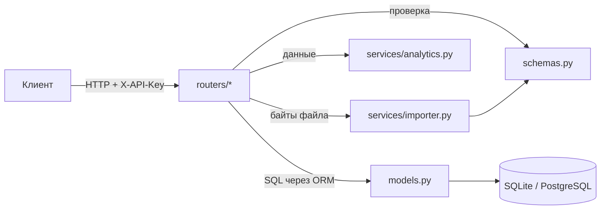

# Finance API

REST API для учёта личных финансов фрилансера: доходы по источникам, расходы по категориям, **доход в час** по каждой площадке, норма сбережений и **прогноз денежного потока** на следующие месяцы.

Стек: **FastAPI**, **SQLAlchemy 2.0**, **Pydantic v2**, SQLite (или PostgreSQL), Docker, pytest.

## Что умеет

| Адрес | Что делает |
|---|---|
| `POST /transactions` | добавить доход или расход |
| `GET /transactions` | список с фильтрами по дате, типу, категории, источнику и постраничной выдачей |
| `GET /transactions/{id}` | одна операция |
| `PATCH /transactions/{id}` | изменить отдельные поля операции |
| `DELETE /transactions/{id}` | удалить |
| `POST /transactions/import` | загрузить CSV (выгрузка банка, старая таблица); повторная загрузка не задваивает операции |
| `GET /stats/summary` | доход, расход, норма сбережений, расходы по категориям, **₽/час по источникам**, доли по правилу 50/30/20 |
| `GET /stats/top-expenses?limit=5` | самые крупные траты за период |
| `GET /stats/monthly` | доход, расход и остаток по месяцам |
| `GET /stats/forecast?months=3` | прогноз на 1–12 месяцев с коридором неопределённости |
| `GET /health` | проверка, что сервис жив (без ключа) |

Все адреса, кроме `/health`, требуют заголовок `X-API-Key`.

### Пример: на какой площадке выгоднее работать

На данных из [`examples/transactions.csv`](examples/transactions.csv) `GET /stats/summary` возвращает:

```json
{
  "income": 112000.0,
  "expense": 32410.0,
  "net": 79590.0,
  "savings_rate": 0.711,
  "expense_by_category": {"еда": 14800.0, "спорт": 7960.0, "техника": 5400.0, "учёба": 2500.0, "транспорт": 1750.0},
  "income_by_source": [
    {"source": "kwork",      "income": 85000.0, "hours": 44.0, "per_hour": 1931.82},
    {"source": "вки нгу",    "income": 18000.0, "hours": null, "per_hour": null},
    {"source": "work-zilla", "income": 9000.0,  "hours": 9.0,  "per_hour": 1000.0}
  ],
  "budget_split": {"needs": 0.148, "wants": 0.142, "savings": 0.711}
}
```

Вывод: час на Kwork приносит почти вдвое больше, чем на Work-Zilla. Сохранено 71% дохода — с запасом выше 20% по правилу 50/30/20.

А `GET /stats/forecast?months=2`:

```json
{
  "method": "linear trend, 80% interval",
  "based_on_months": 4,
  "points": [
    {"month": "2026-10", "income": 45500.0, "expense": 9615.0,  "net": 35885.0, "net_low": 31259.1,  "net_high": 40510.9},
    {"month": "2026-11", "income": 52500.0, "expense": 10220.0, "net": 42280.0, "net_low": 35737.99, "net_high": 48822.01}
  ]
}
```

---

## Запуск

### Локально

```bash
python -m venv .venv
source .venv/bin/activate          # Windows: .venv\Scripts\activate
pip install -r requirements-dev.txt
cp .env.example .env               # и впиши свой API_KEY
uvicorn app.main:app --reload
```

`--reload` перезапускает сервер при каждом сохранении файла — удобно при разработке.

Открой **http://127.0.0.1:8000/docs** — это интерактивная документация (Swagger), которую FastAPI строит сам из кода. Нажми **Authorize**, введи ключ и пробуй любые запросы прямо в браузере.

### В Docker

```bash
cp .env.example .env
docker compose up -d --build
```

API доступно на http://localhost:8000/docs, база лежит в `./data/finance.db` и переживает пересборку.

### Примеры запросов из терминала

```bash
# добавить доход: 12 000 ₽ за 8 часов работы на Kwork
curl -X POST http://localhost:8000/transactions \
  -H "X-API-Key: твой-ключ" -H "Content-Type: application/json" \
  -d '{"date":"2026-10-05","kind":"income","amount":"12000","category":"фриланс","source":"Kwork","hours":8}'

# загрузить пример
curl -X POST http://localhost:8000/transactions/import \
  -H "X-API-Key: твой-ключ" -F "file=@examples/transactions.csv"

# сводка за сентябрь
curl "http://localhost:8000/stats/summary?date_from=2026-09-01&date_to=2026-09-30" -H "X-API-Key: твой-ключ"
```

### Формат CSV для импорта

Разделитель `;` или `,` определяется сам. Даты: `2026-09-15`, `15.09.2026` или `15/09/2026`. Суммы: `1500`, `1 500,00`, `-350.50`.

| Колонка | Обязательна | Значение |
|---|---|---|
| `date` | да | дата операции |
| `amount` | да | сумма. Если нет колонки `kind`, знак определяет тип: минус — расход |
| `category` | да | категория |
| `kind` | нет | `income` или `expense` |
| `source`, `hours`, `note` | нет | источник дохода, часы работы, комментарий |

Строки с ошибками пропускаются, и в ответе указан номер строки и причина.

---

## Структура

```
app/
├── main.py             фабрика приложения: подключает роутеры, защиту, базу
├── config.py           настройки из .env
├── db.py               подключение к базе и сессии
├── models.py           таблица transactions (SQLAlchemy)
├── schemas.py          форматы запросов и ответов (Pydantic)
├── security.py         проверка X-API-Key
├── deps.py             зависимость get_db
├── routers/
│   ├── transactions.py CRUD и импорт
│   └── stats.py        сводка, месяцы, прогноз
└── services/
    ├── analytics.py    расчёты: чистые функции без базы и HTTP
    └── importer.py     разбор CSV
tests/                  21 тест: API через HTTP и расчёты отдельно
examples/               пример CSV
```

Слои и направление зависимостей:



Роутеры знают про HTTP и базу. Сервисы не знают ни про то, ни про другое: получили данные, посчитали, вернули результат.

## Ключевые решения

- **Деньги в копейках, целым числом.** `0.1 + 0.2` во float даёт `0.30000000000000004`, и в суммах начинают «гулять» копейки. Есть тест, который это проверяет.
- **Схемы отдельно от моделей.** Клиент не присылает `id`, наружу идут рубли, а в базе копейки. Таблицу можно поменять, не ломая API.
- **Валидация на входе.** Отрицательная сумма, несуществующая дата, часы у расхода, три знака после запятой — всё отклоняется кодом 422 с объяснением ещё до кода обработчика. Импорт CSV использует ту же схему, поэтому через него мусор тоже не пройдёт.
- **Ключ на уровне роутера.** Защита подключена ко всему роутеру сразу: новый адрес нельзя случайно оставить открытым. Ключ сравнивается за постоянное время (`secrets.compare_digest`).
- **Прогноз не врёт про точность.** Текущий незаконченный месяц исключается, пустые месяцы учитываются нулями, коридор расширяется с горизонтом, а при истории меньше 3 месяцев API честно отвечает «мало данных».
- **Сводка считается в базе.** `GET /stats/summary` суммирует через `GROUP BY`, и в Python приходят итоги, а не все операции. Тест сверяет результат с эталонной реализацией на Python.
- **Фабрика приложения.** Каждый тест получает своё приложение с чистой временной базой.

## Тесты

```bash
pytest -q
```

## Что можно добавить

- Пользователи и вход по JWT вместо одного ключа
- Миграции схемы через Alembic
- Бюджеты по категориям с уведомлением о превышении
- Telegram-бот поверх API: «+1500 kwork 2ч» → запись дохода
- Дашборд с графиками
